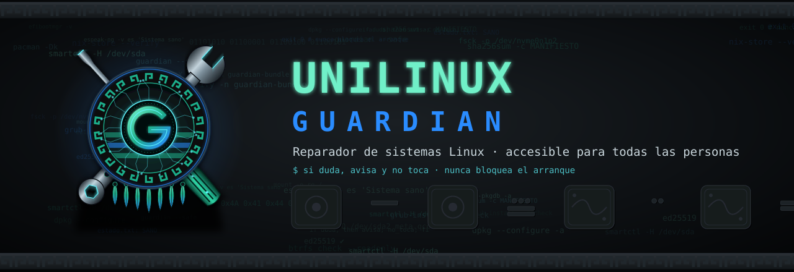

<p align="center">
  
</p>

<p align="center">
  
  
  
  
</p>

<p align="center">
  <b>Reparador de sistemas Linux que trabaja solo, en cada arranque.</b><br>
  Autores: <b>Ahau Quetzalcóatl</b> y <b>Claude</b>
</p>

<p align="center">
  <a href="https://mpago.la/2oVhq8B"></a>
</p>

---

## 🛡️ ¿Qué es Unilinux Guardian?

Unilinux Guardian revisa y repara el sistema **en cada arranque, sin que nadie
intervenga**. Tiene dos propósitos que van juntos:

1. **Evitar que el sistema se dañe.** Detecta y corrige problemas de disco,
   arranque y paquetes antes de que se conviertan en un equipo que no enciende.
2. **Servir a personas con discapacidad.** Fue diseñado para quien **no puede
   tocar el equipo físicamente**, no puede abrir una terminal de rescate o
   depende de otra persona para reparar su computadora. Guardian hace ese trabajo
   por ella y le **avisa con voz** cómo quedó todo.

Su primera regla es **no empeorar nunca las cosas**: si duda, avisa y no toca.

## ♿ Pensado para la accesibilidad

| Necesidad | Lo que hace Guardian |
|-----------|----------------------|
| No puedo tocar el equipo ni usar un USB de rescate | Repara **solo, al encender**, sin teclado, sin ratón y sin menús. |
| No puedo leer la pantalla o leerla me cuesta | **Avisa en voz alta en español** (espeak-ng): «Sistema sano», «Se realizaron reparaciones», «Se necesita revisión». |
| Necesito saber qué pasó sin buscar en registros | Deja un **resumen sencillo** en `/var/lib/guardian/estado.txt` (`sudo guardian --estado`). |
| No puedo quedarme atascado en un arranque fallido | **Nunca bloquea el arranque**: la fase temprana siempre deja continuar. |
| Necesito que mi cuidador o técnico sepa qué hacer | Si un problema no se puede reparar, lo dice claramente (por ejemplo, que hace falta un USB de recuperación) y lo **recuerda en el siguiente arranque**. |
| Prefiero el silencio | La voz y la música se apagan con `--no-voice` y `--no-music`. |

## ⚙️ Cómo funciona

Trabaja en dos fases:

| Fase | Dónde corre | Qué hace |
|------|-------------|----------|
| **guardian-early** | initramfs (POSIX sh, también con klibc) | Revisa el filesystem **raíz antes de montarlo**. Si hay que reparar, primero respalda los metadatos (e2image / btrfs) en un disco aparte. **Nunca bloquea el arranque** (siempre sale con 0). |
| **guardian** (tardía) | sistema en marcha (bash, `multi-user.target`) | Discos (SMART/NVMe), filesystems de fstab **desmontados**, bootloader (GRUB/systemd-boot/UKI), paquetes (dpkg/pacman/rpm/apk/xbps/portage/nix), snapshots, espacio, red y firmware. Escribe el resumen en `/var/lib/guardian/estado.txt`. |

**Reglas del código**
- 🔒 Nunca toca un filesystem montado. La raíz solo la trata la fase early.
- ✅ «Éxito» quiere decir que el problema ya no está, no que se ejecutó un comando.
- ⚠️ Los avisos de hardware (SMART, espacio, firmware) se informan; no se intenta «repararlos».
- 📦 No borra ni instala paquetes por su cuenta.

## 🐧 Distribuciones

| Familia | Initramfs | Instalador |
|---------|-----------|------------|
| Debian, Ubuntu, Mint, Kali, Pop!_OS, Zorin, MX | initramfs-tools | `install-guardian` |
| Arch, Manjaro | mkinitcpio (systemd y busybox) | `install-guardian` |
| Fedora, openSUSE | dracut con systemd | `instalar-dracut` |
| Void (runit), Gentoo (OpenRC) | dracut sin systemd | `instalar-dracut-sinsd` |
| Alpine | mkinitfs | `instalar-mkinitfs` |
| NixOS | módulo `nixos/guardian.nix` | `imports` en `configuration.nix` |
| MiniOS (live modular) | segundo initrd junto al oficial | `instalar-minios` |

Probado con **arranque real** (no solo en laboratorio): Debian 13 (uso diario),
Alpine, Void, Gentoo, NixOS, Ubuntu 26.04, Linux Mint 22, Kali, Pop!_OS, Zorin OS,
MX Linux, Manjaro y MiniOS.

## 🚀 Instalación

```bash
git clone https://github.com/Ahau-quetzal-cohatl/UNILINUX-REPAIR-GUARDIAN.git
cd UNILINUX-REPAIR-GUARDIAN
for t in tests/*.sh; do bash "$t" || echo "FALLA $t"; done   # opcional, sin root
sudo bash bin/install-guardian           # Debian/Ubuntu/Arch y derivadas
# sudo bash bin/instalar-dracut          # Fedora / openSUSE
# sudo bash bin/instalar-dracut-sinsd    # Void / Gentoo
# sudo bash bin/instalar-mkinitfs        # Alpine
```

Para instalarlo en **otro disco** (no el que está en uso) hay que poner
`--sistema-confiable`, porque el chroot ejecuta programas de ese sistema como root:

```bash
sudo bash bin/instalar-en-disco /dev/sdXN --sistema-confiable
```

La configuración va en `/etc/guardian/early.conf`. Opciones principales:
`ON_FAIL`, `BACKUP_UUID` (disco de respaldos), `BACKUP_EXCLUDE` (discos que no se
tocan nunca), `BACKUP_MIN_MB` y `META_MIN_MB`.

## 🧭 Uso

```bash
sudo guardian --safe       # solo diagnóstico, sin cambios
sudo guardian --dry-run    # simula
sudo guardian --estado     # resumen del último chequeo
guardian --help
```

## ✍️ Actualizaciones firmadas

`guardian-actualizar` instala solo un bundle **firmado** (ed25519, `ssh-keygen -Y`,
espacio de nombres `guardian-bundle`). La llave pública va fijada dentro del script;
la que trae el bundle no se usa. Los pasos, en orden:

1. Verifica la firma.
2. Extrae el bundle sin ejecutarlo.
3. Comprueba el manifiesto.
4. Comprueba que la versión sea más nueva (nunca instala una más vieja).
5. Pasa todas las pruebas como usuario sin privilegios.
6. Recién entonces instala.

```bash
sudo guardian-actualizar guardian-vX.Y.Z-bundle.sh   # con el .sig al lado
```

La llave pública está en `guardian-firma.pub`.

## 🧪 Pruebas

En `tests/` hay 23 suites que corren sin root sobre imágenes en archivos (loop).
Simulan cada familia: initramfs-tools, mkinitcpio, dracut con y sin systemd,
mkinitfs, NixOS, MiniOS, subvolúmenes btrfs, `/boot` aparte, UKI, systemd-boot,
rpm y el actualizador firmado.

## 📁 Archivos

```
bin/guardian               fase tardía
bin/guardian-early         fase early (initramfs)
bin/guardian-actualizar    actualizador firmado
bin/install-guardian       instalador Debian/Ubuntu/Arch
bin/instalar-*             instaladores por familia
nixos/guardian.nix         módulo de NixOS
tests/                     pruebas
assets/                    logo y banner
MANIFIESTO.sha256          sumas de bin/, tests/ y nixos/
```

## ☕ Invítale un café al desarrollador

Unilinux Guardian es libre y gratuito. Si te fue de utilidad a ti, a un familiar o
a alguien que cuidas, puedes invitarle un café al desarrollador:

<p align="center">
  <a href="https://mpago.la/2oVhq8B">
    
  </a>
  <br>
  <sub>Pago seguro con Mercado Pago · <a href="https://mpago.la/2oVhq8B">mpago.la/2oVhq8B</a></sub>
</p>

Cada café ayuda a probar más distribuciones y a mejorar la accesibilidad.

## 📜 Licencia

GPL-3.0. Ver [`LICENSE`](LICENSE).

<p align="center">
  <br>
  <sub>Un guerrero informático cuidando tu sistema, para que nadie se quede sin computadora.</sub>
</p>
